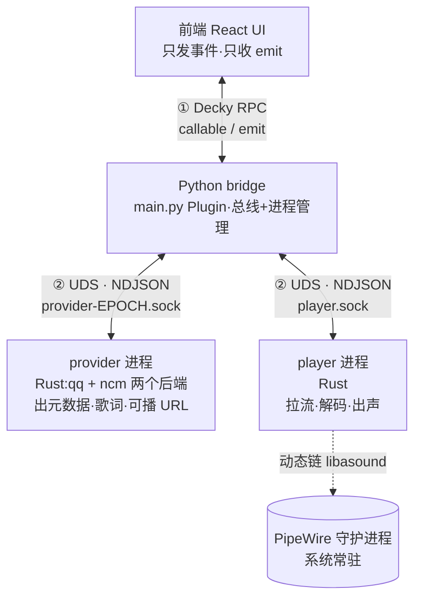
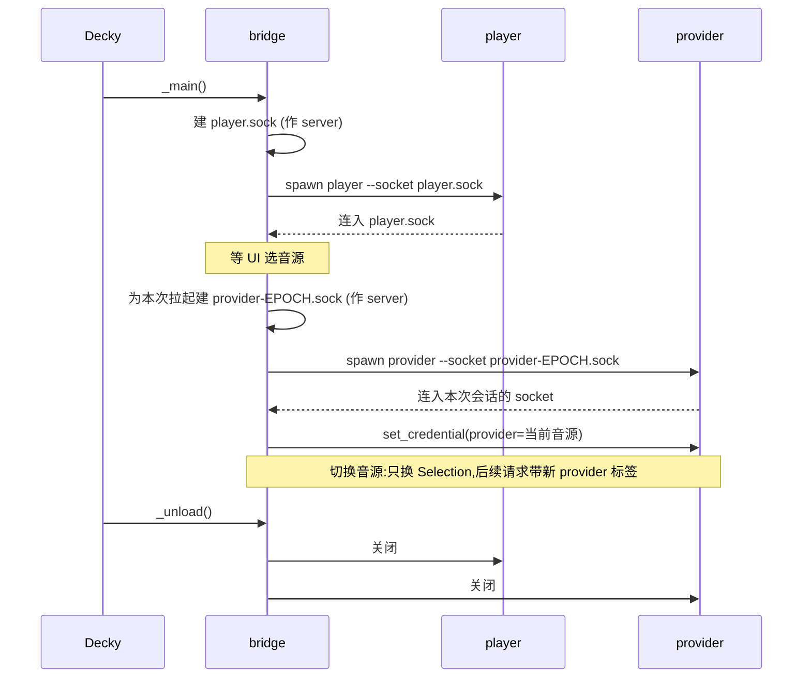

# 总体架构

> 目标:为通用 SteamOS 游戏模式的 Decky Loader 写一个插件,集成 **QQ 音乐** 与 **网易云音乐** 的播放支持,不限定 Steam Deck 品牌。
> 核心思想:**插件本体只做 UI + 通信桥,真正的业务逻辑与音频播放作为独立进程运行在 Decky 沙盒之外**,以换取稳定性与不受 Decky 构建环境约束。
> 兼容范围:x86-64、glibc ≥ 2.39、用户会话 PipeWire + ALSA 兼容层。真机验收记录来自 Steam Deck;
> 非 Deck SteamOS 设备尚缺硬件验收,见 [非 Deck 设备验收](../plan/non-deck-validation.md)。

相关文档:[协议](protocol.md) · [技术选型与分发](tech-stack.md) · [性能](performance.md) · [队列语义](queue.md) · [UI 规则](ui-rules.md)

---

## 背景与约束来源

Decky 插件的后端**不是**独立进程,而是被 loader 用 `multiprocessing.Process` fork 出来的子进程:

- 执行时复用 **Decky 自己 PyInstaller 打包的冻结 Python 解释器**(`backend/pyinstaller.spec`),不是系统 Python,也不是插件自带的 venv。
- 启动时按 Decky 配置的非特权用户降权,除非 `plugin.json` 的 `flags` 含 `root`。插件不要求用户名为 `deck` 或 UID 为 1000。
- 只能通过 `sys.path.append(.../py_modules)` 加载**纯 Python** 模块(`sandboxed_plugin.py:84`)。

**推论:任何带编译扩展的库都不能直接进插件后端。**
需精确匹配 CPython ABI + glibc 的编译 wheel 塞进冻结解释器,必然随 Decky 版本升级而崩。因此 bridge 只用标准库,两个音源都用 Rust 库,合并进一个 provider 二进制(见[技术选型](tech-stack.md))。

**结论:业务后端必须脱离插件进程,以独立二进制运行。** 一旦 bridge `subprocess` 拉起外部二进制,该进程即带自己的运行时、脱离冻结解释器 —— 稳定性与"脱沙盒"由此达成,与二进制内部是一个还是多个无关。

---

## 总体结构

三类角色、多进程,UI 的所有流量强制经过 bridge:

设计红线(用户明确要求):

1. **UI 只跟 bridge 说话**,不知道 provider/player 存在,不直接碰后端。
2. **不走 TCP,全部 unix domain socket。**
3. player 是**独立进程**,与 provider 分离,崩溃互不影响。

---

## 组件职责

| 组件 | 语言/形态 | 职责 | 明确不做 |
|---|---|---|---|
| **UI** | React (TS) | 发控制事件、收状态推送、渲染 | 不碰音频流、不碰 URL、不直连后端 |
| **bridge** | Python (`main.py` 门面 + `py_modules` 实现) | 子进程/连接管理、请求与事件分发、账号与设置持久化;由 `Playback` 负责普通队列/电台、自动切歌、失败重试和播放态回灌 | 不实现音源 API/可播 URL 解析,不拉流、解码或输出音频 |
| **provider** | Rust(一个进程,qq / ncm 两个后端) | 搜索、歌单、歌词、**解析可播 URL**;按请求的音源标签路由 | 不播放音频 |
| **player** | Rust | 拿 URL:HTTP 拉流、解码、seek、音量、推 PipeWire;上报进度/结束 | 不查询音乐 API |

职责分离的意义:provider 崩了不影响正在播放的 player;player 崩了不影响查询;bridge 负责把崩掉的子进程重新拉起。

前端分两层:共享层(shell、顶层 Tabs、状态徽章、`usePlayer`、队列浮层、视觉 token、宿主安全)与 provider 层
(`src/apps/qq`、`src/apps/ncm` 各自的导航和页面)。QQ 与 NCM 是两套产品,不做统一页面树;`SongRow`、搜索、
歌词 / 播放控制骨架、队列浮层等共享原语由两个 app 组合复用。

---

## 进程模型与生命周期

- **player**:常驻。bridge `_main()` 时即 spawn。
- **provider**:一个常驻进程,同时承载 `qq` / `ncm` 两个后端;选定音源后首次需要时拉起,之后常驻。
  切换音源**不换进程**:bridge 只换音源令牌 `Selection(provider, connection)`,之后的请求顶层带新的
  `provider` 标签路由;旧音源若有在跑的扫码登录,bridge 发 `cancel_login` 让它在进程内收尾。
  切换时仍清空当前队列并停止播放,因为 QQ/NCM Song ID 体系不兼容。进程崩溃或判死后由下一条命令重开,
  重连会换新令牌并重新注入当前音源凭证。
- **socket 拓扑**:**bridge 作 server,子进程启动后主动连入**。socket 文件放 `DECKY_PLUGIN_RUNTIME_DIR`(bridge 有写权)。好处:socket 由 bridge 先建好,崩溃重连逻辑集中在 bridge 侧。
- **卸载**:Decky 卸载插件时调 `_unload()`,bridge 关闭两个子进程与 socket。
- **状态归属:bridge 是唯一真相源。** 跨会话/跨 provider 的状态——provider 选择、音量、播放模式、**播放队列 + "放完切下一首"决策**、cookie/账号——全归 bridge 持有(它唯一常驻、不被替换、收得到 player 的 `ended` 事件)。**队列决策绝不放 UI**:否则用户退出播放页去打游戏、UI 卸载 → 当前歌放完就停,不续播。player 放音并托管 MPRIS2、provider 查询音源数据并执行登录/收藏等用户库操作、UI 只显示。
- **持久化:bridge 落盘,单一来源。** 上述状态由 bridge 存 `DECKY_PLUGIN_SETTINGS_DIR`,启动读回恢复。UI 通过 `callable` 读写、自己不落盘(Steam CEF 不能直接写文件);provider 不持久化账号与凭证,凭证由 bridge 在选中音源 / 重连时注入,仅设备身份(`qq-device.json` / `ncm-device.json`)写入 bridge 注入的状态目录 → 重启 / 切换都不丢账号。
- **持久化格式:单文件 `settings.json`(stdlib `json`)。** 冻结解释器只能用 stdlib,`json` 又是全项目通用语,不引第二套序列化。stdlib 其余淘汰:`tomllib` 只读无写入器、`configparser` 表达不了队列 list、`sqlite3` 对小 config 过重。四个必带细节:
  - **原子写**:写临时文件 → `os.replace()` 换名。bridge 可能被 kill,半截写会损坏配置。
  - **schema 版本字段** `{"version":1,...}`:将来改结构可迁移。
  - **不存可再生数据**:绝不持久化解析出的歌曲 URL(限时签名会过期)。普通队列存 id 类字段、展示字段与索引,播放时重新解析 URL；电台流内容与电台模式都不持久化,进入电台会清空已保存的普通队列,重启后按普通队列恢复逻辑处理。
  - **cookie 私有**:文件 `chmod 0600`(deck 用户私有,非世界可读)。
  结构示意:`{"version":1,"provider":"qq","volume":0.8,"play_mode":"list_loop","quality":"high","queue_mode":"normal","queue":{"items":[...],"index":3},"accounts":{"qq":{"musickey":"<...>","musicid":0},"ncm":{"cookie":"<cookie>"}}}`。`accounts` 的值是 provider 登录成功回传的凭证对象(NCM 为 `{"cookie": ...}`,QQ 为 `Credential` 的 snake_case 字段),不是裸字符串。

子进程恢复:连接失效由 `ipc.py` 通知,`supervision.py` 负责按需重启并重新注入状态;player 不在时保留断点,
provider 整体超时后回收并在下一请求重建。二进制缺执行位时 `child_process.py` 在启动前 `chmod`。
架构说明不等于所有恢复路径已验收,故障注入结果见 [`record/`](../record/)。

---

## 当前实现索引

当前以源码模块作为协议与行为的真相源:

| 文件 | 职责 |
|---|---|
| `main.py` | Decky `Plugin` 门面,只把 callable 转发给 bridge |
| [`py_modules/bridge.py`](../../py_modules/bridge.py) | 生命周期门面与任务/持久化回调，组合监督与 RPC 职责 |
| [`py_modules/ipc.py`](../../py_modules/ipc.py) | `Conn` 并发 demux、来源代次、事件顺序消费及连接清理 |
| [`py_modules/music_settings.py`](../../py_modules/music_settings.py) | 配置归一化、队列白名单、原子写与 0600 权限；使用专用名称避免与冻结宿主的 `settings` 冲突 |
| [`child_process.py`](../../py_modules/child_process.py) / [`supervision.py`](../../py_modules/supervision.py) | 环境与启动、子进程自愈、音源令牌 `Selection` 与凭证注入 |
| [`provider_rpc.py`](../../py_modules/provider_rpc.py) / [`playback_rpc.py`](../../py_modules/playback_rpc.py) | 内容/账号与播放控制的外部 callable，保持唯一契约 |
| [`py_modules/protocol.py`](../../py_modules/protocol.py) | 协议 v1 request 构造、response/event/log 严格解码与消息分类;不管理在途请求 |
| [`playback.py`](../../py_modules/playback.py) / [`playback_queue.py`](../../py_modules/playback_queue.py) / [`playback_radio.py`](../../py_modules/playback_radio.py) | 播放意图、同曲重试与恢复；普通队列与电台职责分离，仍由 bridge 持有真相 |
| `src/api.ts` | 前端唯一接口层:callable 声明、事件类型、运行时 guard |
| `wire/src/lib.rs` | 协议 v1 Rust 侧共用:错误码 / 日志 / 请求解析(含 `provider` 路由字段)/ 响应·事件构造 |
| `provider/src/main.rs` | 统一 provider:连 socket、单写出、按请求音源分发到 qq / ncm 后端 |
| `provider/src/ncm/protocol.rs` | 网易云后端的命令 args struct |
| `player/src/protocol.rs` | player 的命令 args struct |
| `provider/src/qq/` | QQ 后端:认证代次、按职责分组命令;`paging.rs` 固定 50 条上游窗口、跨页合并裁剪 |
| `provider/src/ncm/deadline.rs` / `provider_commands/playlists.rs` | 25s 命令预算；按会话/uid/变更版本隔离的有界歌单元数据缓存 |
| `provider/src/lyric/parse.rs` | 两个音源共用的 LRC / YRC 解析、间奏 `end_ms` 与译文对齐 |
| `player/src/loading.rs` / `stream/{buffer,http}.rs` | latest-wins 加载所有权、可取消 HTTP 与有界同步读缓冲 |
| `player/src/mpris.rs` | player 侧 MPRIS2 D-Bus 服务(now-playing 展示 + 控制上送 bridge;zbus 纯 Rust,见[技术选型](tech-stack.md)) |

三项契约的实现与现有回归(同步说明见 [issue #72](https://github.com/jinzhongjia/decky-music/issues/72)):

| 契约 | 实现 | 相关回归与覆盖范围 |
|---|---|---|
| 请求按 id 匹配,事件独立顺序消费 | [`Conn.request` / `_read_loop` / `_pump_events`](../../py_modules/ipc.py) | [`test_child_death.py`](../../tests/test_child_death.py):`TestConnDeath.test_disconnect_fails_inflight_requests_fast`、`TestStaleDisconnect.test_old_connection_eof_does_not_kill_new_one`,覆盖在途请求与连接替换边界 |
| 上游超时重试同一首,仍超时不顺延 | [`Playback._play_index` / `_fuse_check`](../../py_modules/playback.py) | [`test_playback_retries.py`](../../tests/test_playback_retries.py):`TestUpstreamTimeoutRetriesSameSong.test_transient_timeout_plays_the_intended_song`、`test_persistent_timeout_never_skips_to_another_song`、`test_radio_advance_retries_then_reports` |
| 队列与电台决策留在 bridge | [`Playback`](../../py_modules/playback.py),由 [`Bridge`](../../py_modules/bridge.py) 持有 | [`test_playback.py`](../../tests/test_playback.py):`TestQueueEdit.test_clear_and_snapshot`、`test_provider_switch_clears_radio_state`、`test_radio_ended_refills_near_tail_and_advances` |

[`test_protocol.py::TestDemux`](../../tests/test_protocol.py) 验证的是 response/event/log 的消息分类,
不是多请求乱序响应测试。不能把现有连接边界回归描述为所有并发业务竞态都已覆盖。

跨层改动规则:

1. 改 bridge callable 或 emit 事件 → 同步改 `src/api.ts`。
2. 改 bridge ↔ child 协议字段 → 同步改 bridge、`wire`、player、provider 的 protocol 模块与测试。
3. 子进程错误必须返回稳定 `error.code`;日志和错误消息不得包含 URL/cookie/credential。

---

## 核心决策

| 决策 | 结论 | 依据 |
|---|---|---|
| 后端能否进插件进程 | **否** | 冻结解释器 + C 扩展 ABI 绑定(`sandboxed_plugin.py`) |
| 后端形态 | 独立二进制,脱沙盒 | subprocess 拉起即脱离冻结解释器 |
| Rust/Python 是否 FFI 合并成一进程 | **否** | 摧毁崩溃隔离、二者无互调关系、绑定工作量大而无收益 |
| 单进程 vs 多进程 | **多进程**(provider 与 player 分离) | 崩溃隔离,用户核心诉求 |
| 网易云库 | ncm-api-rs(Rust) | 轻量、rustls、静态、1:1 接口 |
| QQ 音乐库 | QQMusicApi-rs(Rust),与 ncm-api-rs 合并为一个 provider 二进制 | 与网易云共用运行时,无冷启动、无首次解包,包体小 |
| UI↔bridge 通信 | Decky RPC(callable/emit) | Decky 唯一原语 |
| bridge↔子进程通信 | UDS + NDJSON,bridge 作 server | 用户要求 UDS/不跨桥;帧格式对齐 Decky `localsocket.py` |
| 通信编码 | NDJSON;bridge 用 stdlib `json`,Rust 侧 `serde_json` | 冻结解释器不能用编译扩展序列化库;控制面流量微小,JSON 够快 |
| 进度上报 | 状态变化时发一次,播放中每 3 秒发一次位置锚点 + wall_ms,UI 本地插值 | 稳态每 3 秒一帧,打游戏时开销很低 |
| player 音频输出 | rodio + 动态链 libasound,gnu 目标 | SteamOS 保证音频栈存在;避开 ALSA 静态 dlopen 死路 |
| 桌面媒体集成(MPRIS) | player 托管 MPRIS2(mpris-server/zbus 纯 Rust);控制上送 bridge、展示读本地态 | bridge 只能 stdlib 写不了 D-Bus;player 是 Rust+常驻+持播放态;维持 ldd 只 libasound |
| 分发 | Decky `remote_binary` 数组 | 原生机制,自带 sha256 校验(`browser.py`) |
| UI 分面 | QAM(共享同一面板,含选源 / 登录 / 账号)+ 大屏路由页(按 provider 挂载各自 app) | 控制与内容浏览解耦 |
| 大屏入口 | 插件加载时注册全部路由;未选音源时页面显示选择提示,左侧菜单入口不注入 | 路由注册简单且卸载时统一移除;可见入口由音源选择决定 |
| 大屏 UI 范式 | 顶层横向 Tabs + 全宽内容区 + Tab 状态徽章;不用常驻左侧栏/底部固定 MiniPlayer | 对齐 SteamOS 官方库范式;避免软键盘压缩视口时底栏被顶起 |
| 手柄导航 | 一切可交互元素包 `Focusable`,禁 hover/纯点击;`L1/R1` 切页,`Start` 盲操,`Y` 队列浮层 | Steam Deck 无鼠标,硬约束 |
| **UI 崩溃隔离(首要)** | 前端零重计算 + 全异步 try/catch + IPC 超时 + 自套 ErrorBoundary + 防御式渲染 | 侵入式插件与 Steam 同 JS 上下文;绝不拖垮宿主 |
| 封面图取图 | 直连 CDN 提供的封面 URL(方案 A),不经 bridge | 静态资源非业务数据,图裂不威胁隔离;见 [UI 规则](ui-rules.md) |
| **状态归属 + 持久化** | bridge 是唯一真相源(provider 选择/音量/队列/cookie),存 `SETTINGS_DIR`;UI 经 `callable` 读写、provider 不持久化账号 / 队列；provider 切换时清空队列 | 唯一常驻不被替换;队列/账号不能放会卸载的 UI 或会退出的 provider;QQ/NCM Song ID 体系不兼容 |
| 持久化格式 | 单文件 `settings.json`(stdlib `json`)+ 原子写 + version 字段 + cookie 0600 | 冻结解释器只能 stdlib;json 全项目通用;sqlite 对小配置过重 |
| 登录 | 统一扫码(QR);凭证由 bridge 存,选中音源 / 重连时注入 provider | 手柄无文本输入友好 |
| 不可用歌曲 | 直接报告用户,不支持代理 / real_ip | 海外/受限网络可用性非本项目目标 |
