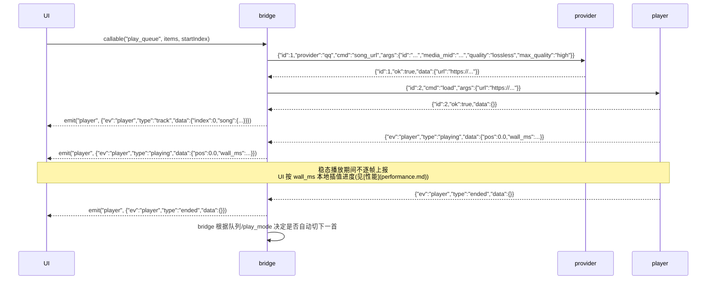

# 通信协议

UI 只跟 bridge 说话;bridge 与子进程走 UDS + NDJSON 协议 v1。总体结构见 [架构](architecture.md)。

## UI ↔ bridge:Decky RPC

Decky 只提供两种原语,足够:

- **`callable(route)`** — 前端 → bridge 的 RPC(底层 websocket,`frontend/src/wsrouter.ts:193`)。前端 `@decky/api` 的 `callable("method")` 直接调用 bridge `Plugin` 类的同名 async 方法。
- **`emit` / `addEventListener`** — bridge → 前端主动推送(`backend/decky_loader/plugin/imports/decky.py` 的 `emit`)。

前端声明全部集中在 `src/api.ts`。事件订阅先按 player / login / provider 的具体类型校验 payload,拒绝数组、缺字段、
非法枚举及非有限数值;畸形事件不调用订阅者。

## bridge ↔ 子进程:UDS + NDJSON + 协议 v1

传输帧**照抄 Decky 自己的内部传输**(`backend/decky_loader/localplatform/localsocket.py`):

- **换行分隔 JSON(NDJSON)**:每条消息一行 `{json}\n`,UTF-8。编码后的 JSON 不得超过 **1 MiB**(与 Decky `BUFFER_LIMIT = 2**20` 对齐)。

四种消息:

| 方向 | 类型 | 形状 |
|---|---|---|
| bridge → child | Request | `{"id":N,"cmd":C,"args":{...}}`;发给 provider 时另带顶层 `"provider":"qq"|"ncm"` |
| child → bridge | Response ok | `{"id":N,"ok":true,"data":{...}}` |
| child → bridge | Response error | `{"id":N,"ok":false,"error":{"code":"...","message":"..."}}` |
| child → bridge | Domain Event | `{"ev":"player"|"login"|"provider","type":T,"data":{...}}`;provider 发的另带顶层 `"provider"` 音源标签 |
| child → bridge | Log Event | `{"ev":"log","level":"debug|info|warn|error","where":"...","msg":"..."}` |

实现约束:

- 构造 / 解码集中在协议模块:bridge `py_modules/protocol.py`;player 与 provider 共用 `wire` crate(通用部分),`player/src/protocol.rs`、`provider/src/ncm/protocol.rs` 只留命令 args struct,QQ 后端参数校验在 `provider/src/qq/args.rs`。
- provider 进程按请求顶层 `provider` 分发到 qq / ncm 后端,缺失或未知音源一律 `invalid_request`;两个后端各自持有凭证与登录任务,共用单一写出通道。
- request id 由 bridge 递增生成。当前 [`Conn.request` / `_read_loop`](../../py_modules/ipc.py) 允许多请求同时在途,
  用 `pending[id] -> Future` 匹配响应,不依赖响应顺序,无主的迟到响应丢弃;写锁只保护单帧写入。
  domain 事件另由 `_events` / `_pump_events` 按到达顺序消费,避免事件处理中的回调请求堵住读循环。
  子进程的响应/事件写回仍经单一 out queue 串行写帧;这不等于把整个请求生命周期串行化。
- 连接来源通过内部 `ConnectionOrigin(epoch, provider)` 绑定：监听会话与每条接入连接都分配进程内不复用的身份；当前生产路径只使用 `epoch`，`provider` 字段保留未用，音源归属以 `Selection(provider, connection)` 为准。
  provider 每次拉起使用独立 `provider-EPOCH.sock`（通过 `--socket` 传入），迟迟未退出的旧进程连不进新会话；
  诊断脚本不得假定固定路径。旧 EOF 不得拆除新连接。
  音源另由 `Selection(provider, connection)` 令牌表示：切换音源或重连都会换新令牌。登出、凭证刷新、
  红心种子等跨 await 的流程只在令牌仍是当前时提交；事件只接收当前令牌所在连接、且音源标签一致的，
  切源时取消正在等待的旧事件回调。登录凭证写入令牌对应的账号槽位，不按消费时的 `settings.provider` 猜测。
- 播放侧通过内部 `is_current` 守卫把意图代次带到 `Conn.request` 的按需启动之后、写锁内实际 write 之前及超时判死之前。
  过期请求在本地取消，不新增 wire 错误码；已写出请求的旧响应不得回灌状态或无条件停止新播放。
  source 选择另有意图代次，旧清空完成后不能覆盖更新的选择；清空等待期间不提前改写旧 provider 的账号槽位。
- 失败响应必须带稳定 `error.code`，`message` 只使用固定安全文案；前端已知码本地化，未知值显示通用错误，不显示或记录不受控异常原文。
- 超时分两级:`timeout` 由 bridge 产出,表示通道不可用或等待子进程响应超时(请求等待上限 30s),
  在播放编排中硬熔断,不逐曲顺延。`upstream_timeout` 由 provider 产出，表示上游或完整命令预算耗尽；NCM 完整命令 25s，单段最多 15s 且不超过剩余预算。
  [`Playback._play_index`](../../py_modules/playback.py) 对 `song_url` 首次上游超时退避 0.5s,
  原地重试同一首一次;若仍为 `upstream_timeout`,按 `FUSE_ERRORS` 硬熔断并报错,不跳到其他歌曲。
  重试结果若变为其他错误码,按对应分类处理;跨歌曲连续两次的软熔断只适用于 `SOFT_FUSE_ERRORS` 中的 `fetch_failed`。
- 子进程诊断走 `Log Event`，producer 不输出秘密；bridge 对不受控日志正文和 stderr 只保留受控类别/错误码或固定摘要，不原样落盘。
- 每端在 JSON 解码前以字节数强制 1 MiB 上限:超限入站帧立即断开,bridge 拒绝超限 request(`invalid_request`),子进程停止向该连接写入。不得为诊断把原始帧写日志。

> 关于 provider 包裹:ncm-api-rs 与 QQMusicApi-rs **都作为库使用**,在同一个 Rust 二进制里各写一层后端,暴露上述 NDJSON-over-UDS 协议(不用 ncm-api-rs 自带的 axum HTTP server)。两个后端协议一致,bridge 统一对待。

## 一次"播放"的完整流转

UI 全程拿不到 URL、碰不到音频流,一切经 bridge。

## 为什么 UDS 而非 TCP

- 无端口占用问题:Decky 自身用 1337/8080(README「Common Issues」),UDS 完全绕开端口冲突。
- 本机进程间通信,天然不暴露网络监听面。
- 与 Decky 自身传输范式一致。

## 播放错误上报

播放错误走双通道:插件 UI 内的 `ErrorBanner` + Steam 系统 toast。播放出错时用户多半不在插件界面(在玩游戏),只有横幅等于没提示。见 `src/player/usePlayer.ts`。
